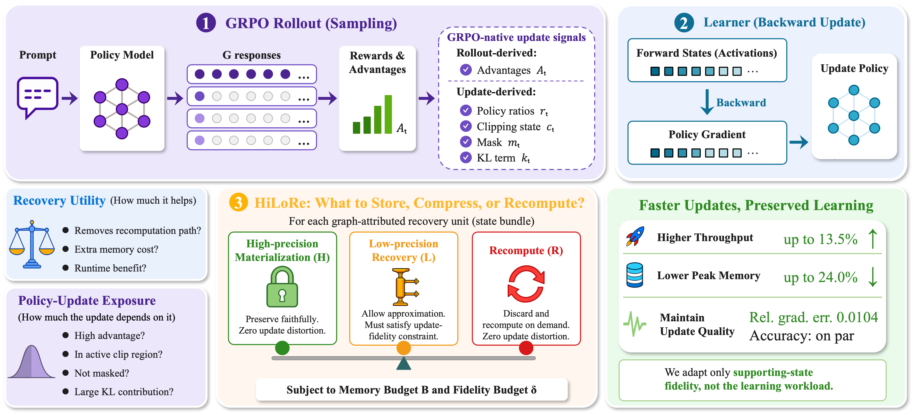

# HiLoRe: What to Store, Compress, or Recompute for Efficient GRPO Training

Code for the paper **"HiLoRe: What to Store, Compress, or Recompute for Efficient GRPO Training"**, focusing on **Qwen2.5-3B-Instruct / DeepMath10K** with gradient checkpointing (GC) and HiLoRe.

## 📖 Overview

HiLoRe reduces backward recomputation by choosing how to recover activation state under memory and update-risk budgets. It preserves the forward computation and GRPO workload, using three recovery actions:

- **H — Store:** retain the original-precision state.
- **L — Compress:** recover selected BF16 MLP state through direct FP8 E4M3FN conversion; retain other required state exactly.
- **R — Recompute:** replay the region from saved execution state.

Microbatch profiling estimates recovery utility and memory cost; a complete GC–HiLoRe update pair validates the selected plan. Calibration uses 16 training microbatches; allocation then refreshes after each microbatch forward using the current GRPO update signal.




## 🚀 Quick Start

### 1. Installation

Use Python 3.10, Linux and four CUDA GPUs. The paper uses four NVIDIA L40S 48-GB GPUs. Profiling requires NVML and dedicated devices.

```bash
python -m pip install -r requirements.txt
```

### 2. Prepare data

Provide local JSONL snapshots of DeepMath, MATH500 and the GSM8K test set:

```bash
python -m hilore.prepare_data --source /xxx/data/deepmath.jsonl \
  --math500 /xxx/data/math500.jsonl --gsm8k /xxx/data/gsm8k-test.jsonl \
  --output /xxx/data/prepared

SPLIT_MANIFEST=/xxx/data/prepared/manifest.json bash scripts/check_data.sh
```

This creates 10,000 training problems, 2,048 validation problems and a frozen manifest.

The default configuration expects 60 updates; GC and HiLoRe must use identical replays.

### 3. Switch from GC to HiLoRe

**For Qwen2.5-3B with prepared actor replays: initialize once, then launch HiLoRe—no code edits or manual tracing rules.** Run from the repository root with your local paths:

```bash
# 1. Set paths and a trial risk budget
export MODEL_PATH=/xxx/models/Qwen2.5-3B-Instruct
export SPLIT_MANIFEST=/xxx/data/prepared/manifest.json
export UPDATES_DIR=/xxx/replays
export RISK_BUDGET=0.010

# 2. Initialize using development replays from the training split
UPDATES_DIR=/xxx/development-replays OUTPUT_DIR=/xxx/initialization \
  bash scripts/initialize.sh &&

# 3. Launch with the generated profile after initialization succeeds
PROFILE_PATH=/xxx/initialization/profile.json DEVELOPMENT_PROFILE=1 \
  OUTPUT_DIR=/xxx/runs/hilore bash scripts/run_actor.sh hilore
```

`0.010` is a trial budget; `DEVELOPMENT_PROFILE=1` permits development runs before terminal task-quality selection. Keep the [default configuration](configs/qwen25_3b_deepmath.json), use new output directories, and use `export DRY_RUN=1` to preview the commands.

## Initialization protocol

Initialization uses one complete development replay from the training split: the first `update_*.pt` file in lexicographic order, or the file named by `VALIDATION_RECORD`. The most frequent shape class with at least 16 microbatches supplies profiling and calibration inputs; other shapes use exact R recovery.

The default initializer ranks decoder bundles by attributed recomputation time per estimated captured byte and shortlists at most eight units. It verifies H/L recomputation elimination only for these units, then calibrates every admitted L unit on the same 16 microbatches. Candidate capture uses H fractions 0, 0.5 and 1, with duplicate plans removed.

Conditional utility is estimated on matched microbatches using one warm-up and two timed repetitions. Inputs, RNG states, distributed execution and complete-update loss normalization are preserved. Capture-byte estimates only guide candidate construction; microbatch memory increments are anchored to the measured complete-GC peak for allocation. Dynamic microbatch measurements select one plan, followed by at most two rounds of leave-one-out screening without reallocating the omitted unit's budget during each comparison.

Initialization executes one complete GC reference and one complete HiLoRe validation update, with no additional complete-update warm-up. The reference is measured once and retained. Acceptance requires a complete-update peak within the GC-relative ceiling, relative accumulated-gradient error at most 0.015, and faster complete-update execution than GC. Single-pair validation supplies no timing standard deviation and does not replace repeated held-out evaluation or terminal task-quality selection. A rejected plan exits with a nonzero status; an All-R fallback is not reported as successful initialization.

`CANDIDATE_LIMIT`, `MICROBATCH_REPEATS` and `INTERACTION_ROUNDS` override defaults 8, 2 and 2. Initialization records the protocol, selected record, candidate units, execution counts, stage wall times and total wall time in `profile.json`. Actual initialization time must be measured on the target hardware; no one-hour runtime is guaranteed. Schema-2 profiles must be regenerated. The schema-3 loader rejects incomplete, failed and rejected profiles. Successful profiles remain development-only until terminal quality selection is completed.
